# We Have RaceRender At pHone

*WHRRAH Android*

A phone-based data logger, lap timer and video overlay app for autocross, built to replace an AiM Solo.
A **RaceBox Mini** supplies 25 Hz GPS + motion, a **DJI Osmo Action 4** records the video (started from
DJI Mic Mini remotes), and the phone ties them together: live lap time and delta on the dash during the
event; afterwards, clips matched to runs, synced to the data, played back with a data overlay and
rendered to the gallery.

Native Android counterpart to the desktop app (https://github.com/LUNK333/WHRRAH) — overlay layouts are
the same JSON files in both. Scope and direction: [docs/design-doc.md](docs/design-doc.md). Work in
progress and the session log: [docs/TASKS.md](docs/TASKS.md).

## What it does

| | |
|---|---|
| **Sessions** | One folder per event (`<event>_<date>`), driver + car lists, everything in `session.json` |
| **Co-driving** | Tag each run's driver; runs are numbered per driver (each driver's 1st, 2nd… run); the other driver's runs are tinted; each driver's best run gets a gold outline and ★ |
| **Track** | Record the course walk; set the start and finish lines while walking (big buttons; moving a set line, a new walk and continuing a walk all need a long-press + confirm); change a line's width in place; nudge it ±1 m along the walk |
| **Timing** | Start from the **launch**: the clock starts once the car has moved 6 m from its last stop in the stage (pinned by the RaceBox accelerometer), finish at the finish line — interpolated between 25 Hz fixes on GNSS time. Copes with rolling over the start line while pulling up and with being staged over it |
| **Official times** | Per run: official time, cones (+2 s each), DNF; **Calibrate** fits the app to the timing system (at NE-SVT #16: ±0.04 s vs 16 official times) |
| **Live timer** | Portrait card, and a landscape dash layout that changes through the run (idle → staged → on course full screen → finished), full screen brightness, optional HDR |
| **Live delta** | Against the session's best clean run, as 10 + 10 chevrons or boxes (0.2 s each): red left = behind, green right = ahead |
| **RaceBox** | BLE, 25 Hz position + G + rotation rates, logged per run; any mounting (the motion channels are rotated into the car's frame) |
| **Camera** | Bluetooth-only during the session (DJI R-SDK remote: recording start/stop + status); warns if the camera's in the wrong mode |
| **Match clips** | One WiFi visit after the event: lists the camera's clips, matches them to runs by time + length (works out the camera's clock), pulls each clip's gyro |
| **Video sync** | Clip gyro cross-correlated with the RaceBox rotation: video t = 0 pinned to the data clock, with a match score |
| **Run viewer** | YouTube-style player streaming off the camera (or the phone's copy), trimmed to the lap ± padding (5 s / 10 s); fullscreen when turned sideways; swipe a run right to download it, left to delete the copy, long-press to export or remove the clip |
| **Overlay** | Desktop WHRRAH layouts (Lap Timer, Numeric Display, Bar Graph, Track Map, Data Trace, G Meter) drawn over the video from the run's data |
| **Export** | Renders a run to the gallery (Movies/WHRRAH): overlay burned in and cropped to the layout's frame, trimmed to the padded lap — straight from the camera if the clip isn't on the phone |
| **Downloaded runs** | Every session's downloaded clips in one list, playable with no camera or WiFi |
| **Background** | Foreground service keeps camera / RaceBox / GPS connected when minimized; screen stays on in the app |

Not done yet: ESP32 CAN and ELM327 data; layout editing on the phone (layouts come from the desktop app).

## User guide

### One-time setup (Dev options)

1. **RaceBox test panel** → Scan → connect. The rate should read ~25 Hz.
2. **Camera test bench** → Scan → connect, then let it join the camera's WiFi once (approve on the camera,
   accept Android's prompt). This saves the camera's WiFi name + password, which Match clips and the
   viewer use later. **Check camera setup** records a 3 s clip and confirms it carries gyro.
3. **Settings**: add the drivers and cars you use, the start / finish line widths (finishes default to
   100 ft — they can be runway-wide), and display options (times in seconds, delta style, brightness).

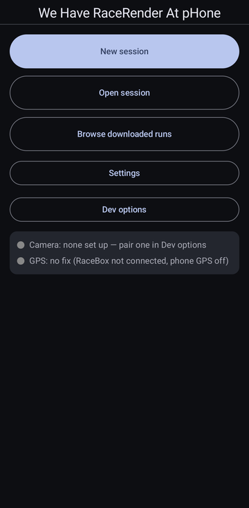 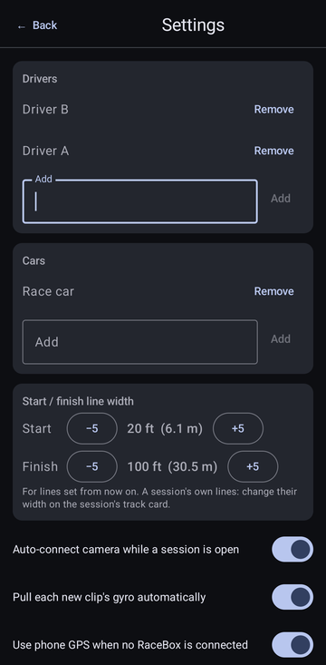

### At the event

1. **New session** → event / driver / car. The camera (Bluetooth) and RaceBox connect on their own; the
   first time, approve the remote on the camera's screen. The session screen has the lap timer, the
   connections, the track card and the runs.

   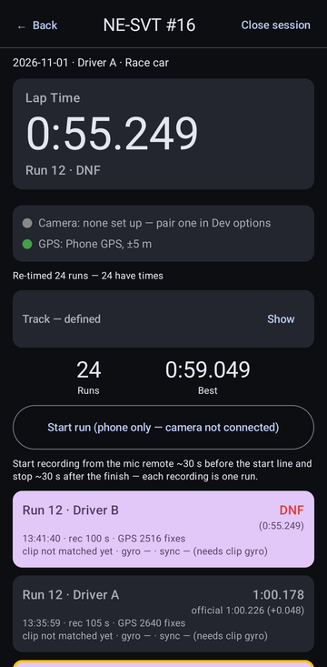

2. **Track walk**: tap **Record track walk** at the start of the course walk. Walk toward each line in
   the driving direction, stand on it (at the timing gate), and tap **Set start** / **Set finish** — the
   buttons light up green / red once set. Stop recording. The track card shows the walk and both lines,
   each line's width (widen a runway-wide finish here) and the timing calibration.

   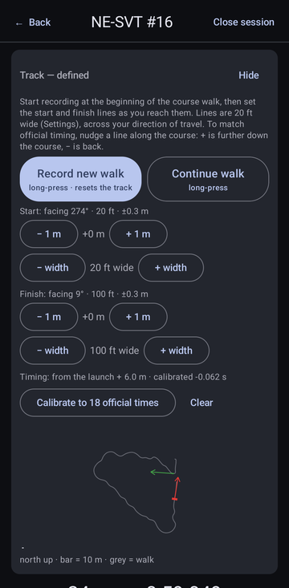

3. **Runs**: start recording from the Mic remote before you pull up to the line, stop after the finish —
   each recording is one run. Or use the phone's **Start run** button (which also starts the camera).
4. Turn the phone sideways for the **dash layout**. It changes through the run:

   **Idle** — the last run's time, a big Start run button:

   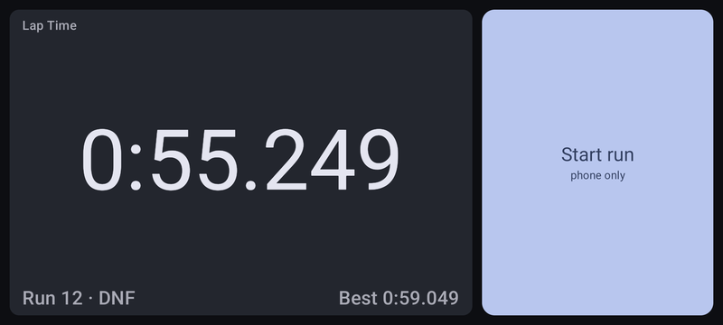

   **Staged** — recording, waiting at the start: the button narrows and the delta bar comes up:

   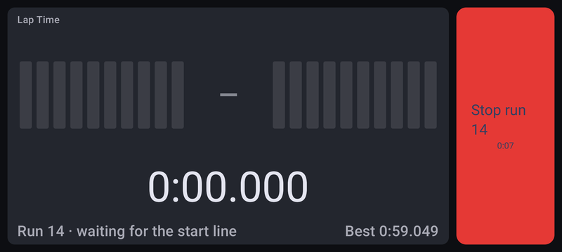

   **On course** — the timer fills the screen; the delta bar shows how far ahead (green, right) or
   behind (red, left) of the session's best run you are, 0.2 s per box; the blinking dot means it's recording:

   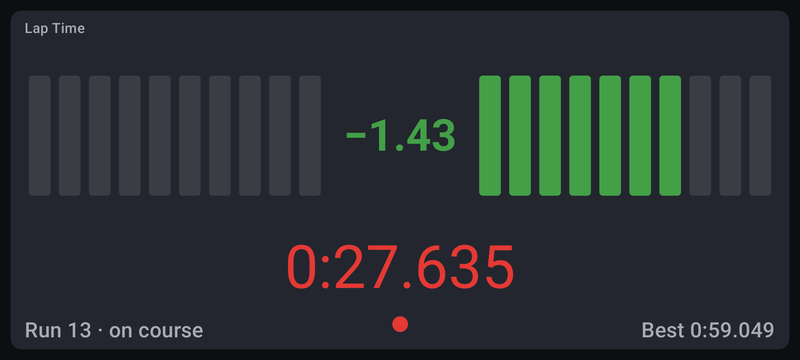

   A sideways swipe brings the **Stop** button back for a few seconds:

   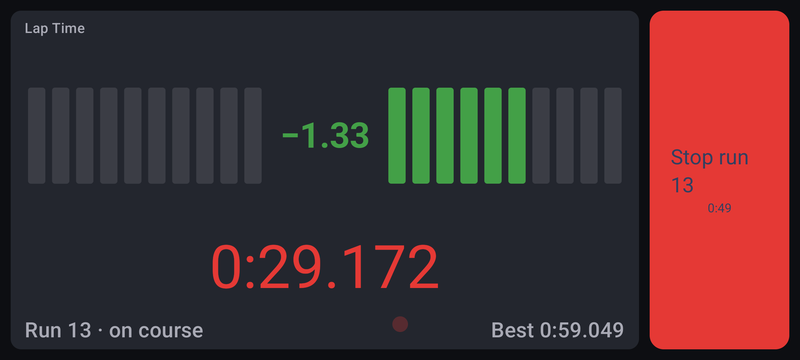

   **Finished** — past the finish line: the time turns green and the layout goes back to the idle sizes
   (the button is now Stop run):

   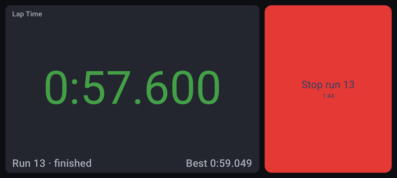

   The header (Back, Close session) hides in landscape — swipe up to bring it up.

5. **After each run**, long-press it to fill in the run menu (see below) — it can be done right away,
   not just after the event, and it's what keeps the live display honest: mark a **DNF** (off course)
   so that run is never used as the delta reference, set the **driver** when co-driving, and add
   **cones** and the **official time** as they're posted. Calibrating as soon as there are an official
   time or two makes the live timer match the timing system for the rest of the day.

### After the event

1. **Official times** (if not done during the event): long-press each run → driver, cones, DNF and the
   official time. The run list shows the time with cones, the official time and the difference.

   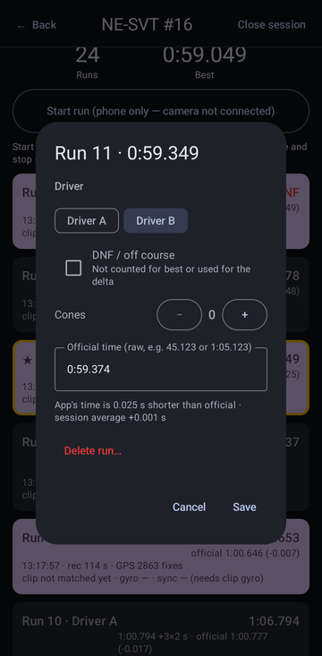

2. **Calibrate** (track card → *Calibrate to N official times*): fits the app to the timing system — one or
   two official times are enough. It leaves out anything more than 0.5 s off the rest (usually a typo)
   and says which run.
3. **Match clips (camera WiFi)**: pairs the camera's clips with the runs and pulls their gyro; runs then
   sync to the video on their own.
4. **View runs (camera WiFi)**: tap a run to play it. Tap the video for the controls (previous / play /
   next run, seek, fullscreen); the ⚙ sheet has the overlay switch, layout and the pad before / after
   the lap. Swipe a run right to download its clip, left to delete the phone's copy; long-press to
   **export** it (with or without the overlay, padded or whole) or to remove a clip from the session.
5. **Browse downloaded runs** (main menu) plays everything already on the phone, without the camera.

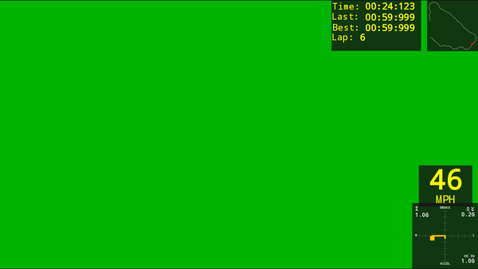

*The `layout_phone` overlay drawn from a run's data (Dev options → Overlay preview, no video).*

### Overlay layouts

Layouts are desktop WHRRAH layout JSON files: copy them into
`Android/data/com.lunk333.whrrah/files/layouts/` (one is bundled). Channels use the desktop's AiM names:
`GPS Speed` (mph), `GPS Latitude` / `Longitude`, `GPS Heading`, `GPS LonAcc` / `GPS LatAcc` (G, from
GPS), and from the RaceBox in the car's axes `InlineAcc`, `LateralAcc`, `VerticalAcc`, `RollRate`,
`PitchRate`, `YawRate`. The Lap Timer widget counts from the start and holds the lap time at the finish
(with the calibration); Last / Best are that driver's.

### Accuracy (NE-SVT #16, 16 runs with official times)

- Lap times: **±0.043 s** (sd) against the official times, worst run 0.09 s.
- RaceBox: 25 Hz with no dropped fixes, ±0.3 m reported.
- Video sync: r ≈ 0.83–0.92 per clip (helmet-mounted cameras will be weaker — head movement).
- GPS absolute position drifts 1–2 m over a day. Timing is mostly immune (the start uses distance
  travelled; the finish is a wide line), but compare driving lines between runs only after aligning them.

### Known gotchas

- **AdGuard / any non-bypassable VPN** blocks the camera WiFi: exclude WHRRAH or pause it.
- **Wireless Android Auto** and the camera WiFi knock each other out.
- After being used as a remote the camera ignores WiFi pairing, so the app joins with the **saved** WiFi
  password. If the camera's WiFi is reset, re-pair it once in the Camera test bench (no session open).
- For ~9 s after any clip listing the camera sits in viewer mode and won't start recording.
- Only some Action 4 recording formats carry the 1 kHz gyro; clips without it can't be synced.
- A line keeps the width it was set with: widen it on the track card (not in Settings) for an existing session.

## Session files

On the phone at `Android/data/com.lunk333.whrrah/files/sessions/<event>_<date>/` (reachable over USB):

```
session.json          the project file: lines, runs, clip matches, times, sync, calibration
gps/trackwalk.csv     course walk trace
gps/lapNN.csv         per-run position log   (elapsed_ms, utc_ms, lat, lon, speed, heading, accuracy, source)
imu/lapNN.csv         per-run RaceBox motion (elapsed_ms, wall_ms, utc_ms, g_x/y/z, roll/pitch/yaw °/s — RaceBox axes)
gyro/lapNN_<clip>.csv the matched clip's camera gyro (t_ms from clip start, w, x, y, z)
video/                downloaded clips (+ thumbs/)
```

`NN` is the run's session number (shared by both drivers). Per run, `session.json` holds the recording
start/stop (phone clock), the lap time and the start / finish times (GNSS clock), driver, cones, DNF and
official time, the matched clip with its start/length/offset, and `videoStartMs` (video t = 0 on the data
clock) + `syncR`. The session holds the lines, the start distance and calibration offset, the camera clock
offset and any clips removed by hand. Exports go to the gallery under Movies/WHRRAH.

## Building

Open the folder in Android Studio and Run. There's no `gradlew` script in the repo; from a terminal, use
Android Studio's JDK and its cached Gradle 8.13:

```
JAVA_HOME="C:/Program Files/Android/Android Studio/jbr" ~/.gradle/wrapper/dists/gradle-8.13-bin/*/gradle-8.13/bin/gradle :app:testDebugUnitTest :app:assembleDebug
adb install -r app/build/outputs/apk/debug/app-debug.apk
```

Unit tests (JVM, 108) cover what can be pinned down off-device: the gyro decoder against the Python
reference, UBX/RaceBox parsing, line geometry, path-following nudges, launch-based lap timing (staged over
the line, pulling up), the live delta (synthetic courses, hairpins, dropouts), per-driver numbering and
bests, clip matching, gyro sync, the overlay's layout JSON round-trip and run data, session storage, and
osmosis's own Action 4 manifest and R-SDK tests.

## Code layout

`app/src/main/java/com/lunk333/whrrah/`

| | |
|---|---|
| `ui/AppScreens.kt` | Home, new/open session, session screen (timer, landscape dash, track, runs, run menu), settings, dev options |
| `ui/RunViewer.kt` | Run viewer + downloaded runs: player, overlay, download / delete / export |
| `ui/OverlayPreview.kt`, `ui/Brightness.kt`, `ui/Splash.kt` | Dev overlay preview, full brightness + HDR, launch splash |
| `session/` | `SessionController` (runs, logging, timing, Match clips, downloads), `Session` model + store, `LapTimer` (launch-based timing), `LapDelta` (live delta), `ClipMatcher`, `GyroSync` |
| `overlay/` | Desktop layout JSON model, widget renderer, run data (AiM channel names) |
| `export/` | `ClipExporter`: Media3 Transformer render to the gallery |
| `gps/` | `GpsSource` (+ phone GPS fallback), `Geo`, `TrackPath`, heading estimate |
| `racebox/` | UBX framing + Data Message parser, BLE client, test panel |
| `osmo/` | `CameraMonitor` (Bluetooth R-SDK remote), `OsmoLink` (pair → WiFi → list → gyro / thumbnails / downloads), camera test bench |
| `osmo/gyro/` | djmd gyro decoder (Kotlin port of `WHRRAH/wifi_gyro_sync/osmo_wifi_gyro.py`) + range readers |
| `settings/` | Drivers, cars, line widths, display options, time format |
| `LinkService.kt` | Foreground service keeping the links alive in the background |
| `data/`, `xrk/`, `canvas/`, `video/` | Earlier prototypes: CSV/XRK viewer (Dev options), first overlay canvas, video player |

`app/src/main/java/dev/konraditurbe/osmosis/` is **vendored** from
[osmosis](https://github.com/KonradIT/osmosis) (MIT): DUML framing, GATT client, WiFi join, the UDP
datalink media list, and the R-SDK protocol. A few small local patches, all marked `WHRRAH patch` — see
[VENDORED.md](app/src/main/java/dev/konraditurbe/osmosis/VENDORED.md) before re-copying any of it.

## Legacy: libxrk / `.xrk` import

The CSV/XRK viewer under Dev options uses libxrk (https://github.com/m3rlin45/libxrk) through a
hand-written JNI shim in `rust/xrk-ffi/`; the `.so` files in `app/src/main/jniLibs/` are prebuilt and
checked in. Only needed again for testing against AiM data. To rebuild: clone libxrk next to this repo,
install the Android targets + NDK + `cargo-ndk` (and MSVC build tools on Windows), then from
`rust/xrk-ffi/`:

```
cargo ndk -t arm64-v8a -t armeabi-v7a -o ../../app/src/main/jniLibs build --release
```
